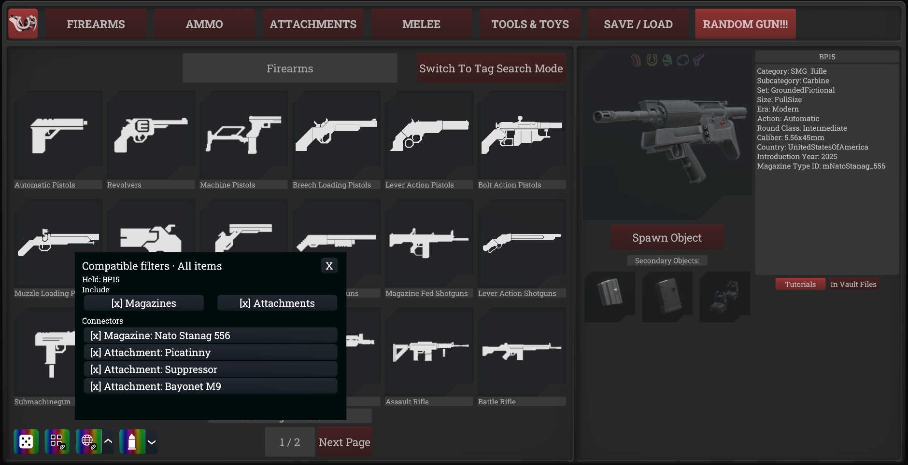
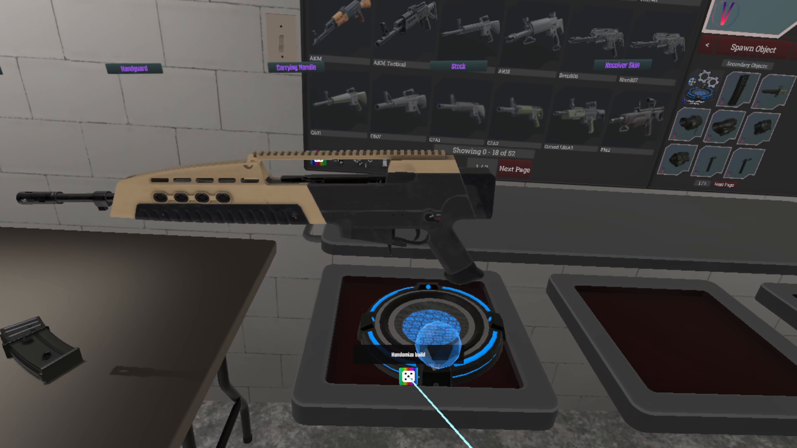

# Gundomizer

Randomize items directly in **Item Spawner V2**, including the **toolbox tablet**, in classic and tag-search modes.

## Features

- **Random item:** roll from the current category and its subcategories, or your selected tags, across all pages.
- **Compatible section:** grid + link rolls items that fit what you're holding, within the current section or tags.
- **Compatible catalog:** globe + link searches all items, with type and connector filters in its dropdown. Choices last for the session.
- **Random ammo:** roll a compatible ammo variant. The arrow beside it opens the variant toggles.
- **Spawn or preview:** spawn immediately, or select a result to inspect, accept, or reroll.
- **Auto-fill:** replace loaded rounds and fill the held magazine or weapon, while still spawning the loose round.
- **Continuous search:** shows loading progress; click the active button again to cancel.

## Quick setup

1. Install with r2modman or Thunderstore Mod Manager, including **BepInExPack H3VR**.
2. Launch H3VR using **Start modded**.
3. Use the rainbow buttons in **Item Spawner V2** or its **toolbox tablet**.

## [NEW] Modul's Support

For weapons using **Modular Workshop**:

- **Slot dice:** reroll that part or skin without repeating the current choice.
- **Platform dice:** reroll the whole build, including nested parts and skins. Click again to cancel.

Uses the weapon author's randomization pools and exclusions. Modular Workshop is optional.

## Mod compatibility

Tested with **Modul / Modular Workshop** content, **OtherLoader**, and **OtherLoaderPatched**. These mods are optional.

## Optimization

A background metadata index checks compatibility without loading entire assets just to inspect their connectors. It's saved between launches and updates changed packages, making rolls faster as indexing completes.

## Mod Options

- **Spawn Item Instantly** — ON: spawn immediately; OFF: preview first.
- **Auto Fill Held Item** — ON: refill with the rolled ammo after spawning.
- **Persistent Connector Index** — ON: build and reuse the metadata cache.
- **Reset Metadata Indexing** — OFF: clear and rebuild the cache once, then switch itself off.

Edit `quaternion.gundomizer.cfg` through your mod manager's Config Editor. Requires **BepInExPack H3VR**.

## Feedback

For feedback or support, join the [H3VR Homebrew Discord server](https://discord.gg/Hggg7wh) and look for **@quaternion**. When reporting an issue, include your BepInEx log, mod list, and steps to reproduce it.

## Credits

- Special thanks to Glicen for requesting and sponsoring the mod.
- Anton Hand and RUST LTD. for **H3VR**.
- The **H3VR Homebrew community**, mod authors, and tool and loader maintainers.
- **nesrak1 / AssetsTools.NET** for the bundle metadata reader library.
- The **Modular Workshop** and modular weapon authors for their framework, platform, parts, and skins.

## Support

Tips and donations are welcome on [Ko-fi](https://ko-fi.com/quaternion7). You can find my other projects and links at [quaternion7.github.io](https://quaternion7.github.io/).

## Changelog

- **Unreleased:** Modular Workshop part, skin and build rolls; separate section/catalog buttons; quieter click feedback.
- **1.1.0:** Compatible type/connector filters, cross-category magazine rolls, a chain-link icon, and improved ModulAK indexing.
- **1.0.2:** Fix missing buttons with OtherLoaderPatched and support its custom categories.
- **1.0.1:** DLL-only metadata reader with reusable decompression buffers.
- **1.0.0:** First public release: item, compatible gear and ammo rolls, optional auto-fill, and persistent background indexing.

[Development version history](https://github.com/quaternion7/gundomizer/blob/main/CHANGELOG.md)

## Disclosure

I use AI and LLMs to help speed up development. I have a full-time job, and these tools make it practical to keep building and maintaining mods in my spare time.

My background in game development predates today's AI tools, and I have the skills to do this work without them. I choose to use them because they save time and let me focus more on gameplay, hands-on setup, testing, and polish. The design decisions, review, and responsibility for the finished mod remain mine.
